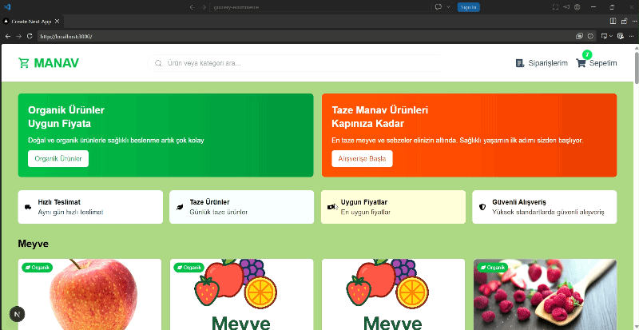

# 🥦 E-Grocery Manav Projesi

Bu proje, Next.js, TypeScript ve Tailwind CSS kullanılarak geliştirilmiş modern bir online market alışveriş uygulamasıdır. Kullanıcılar ürünleri kategorilerine göre görüntüleyebilir, sepetlerine ürün ekleyebilir ve ödeme adımına geçebilir.
 
 ---

## 🚀 Özellikler

-  Ürünleri kategorilere göre filtreleme
-  Sepete ürün ekleme
-  Sepetteki ürün miktarını artırma ve azaltma
-  Sepeti tamamen temizleme
-  Sepetteki toplam tutarı görüntüleme
-  Stripe ile test ödemesi yapma
-  Ürün ekleme ve silme işlemlerinde bildirim gösterme
-  React Icons ile şık ikonlar
-  Mobil uyumlu ve responsive tasarım

---

## 🛠️ Kullanılan Teknolojiler

- Next.js
- TypeScript
- Tailwind CSS
- Stripe
- React Toastify
- React Icons

---

## 📸 Önizleme

